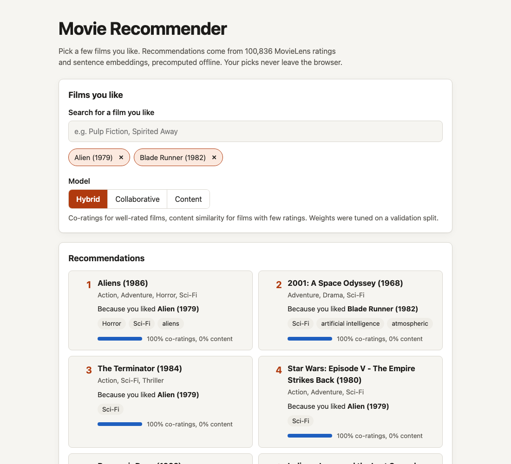
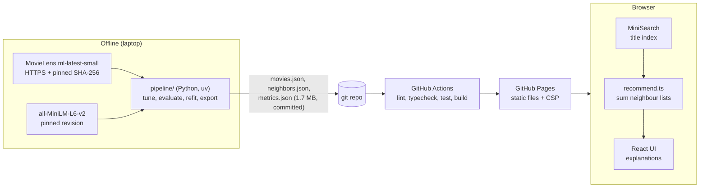
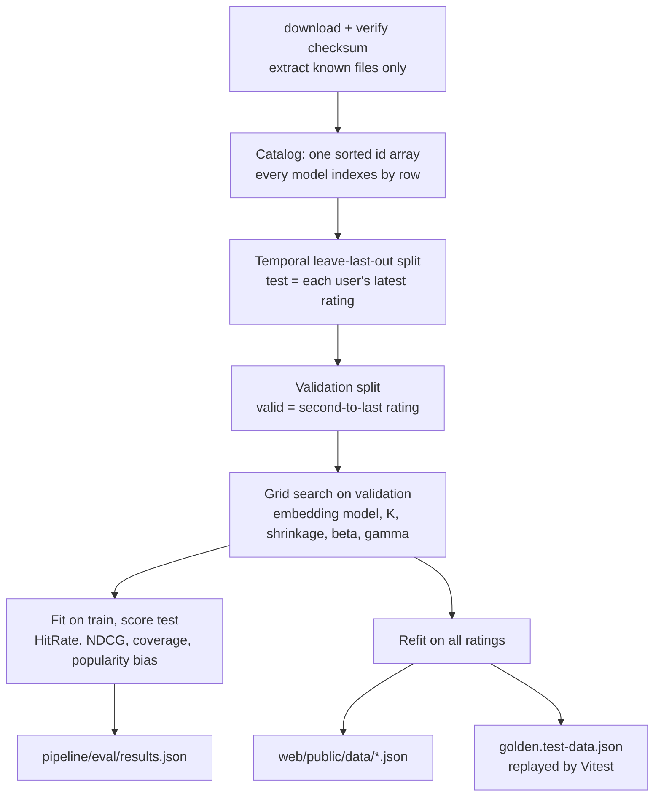

# Movie Recommendation

Pick a few films you like and get ranked, explained recommendations from MovieLens ratings and sentence embeddings, all precomputed offline and served as a static site.



**Live demo:** https://shashank11yadav.github.io/Movie-Recommendation/ (GitHub Pages, deployed from `main`)

## What it does

- Fuzzy, accent-insensitive title search over 9,742 MovieLens films, fully keyboard operable.
- Pick up to 10 liked films. Their neighbour lists are summed in the browser to rank recommendations.
- Switch between three models: **content** (sentence embeddings), **collaborative** (item-kNN over co-ratings) and a **hybrid** that falls back to content for films with too few ratings.
- Every result says which of your films drove it ("Because you liked Alien"), which genres and tags they share, and how much of the score came from co-ratings vs content.
- An "About the model" panel shows the offline evaluation below, read from the same JSON the pipeline writes.
- The selection lives in the URL fragment (`#liked=296,1&model=collab`), so a result page can be shared. Nothing is sent anywhere.

## How it works

There is no backend. A Python pipeline does all of the modelling and writes three JSON files; the frontend is a static Vite build that loads them.



The model pipeline, from download to export:



**Content model.** Each film becomes a short text, for example `Pulp Fiction (1994). Genres: Comedy, Crime, Drama, Thriller. Tags: quentin tarantino, ...`, built from the title, year, genres and up to eight of its most-applied user tags (tags about viewing logistics such as "in netflix queue" are dropped). The text is embedded with `sentence-transformers/all-MiniLM-L6-v2` and each film keeps its top K cosine neighbours.

**Collaborative model.** Item-kNN on the binary user-by-film matrix with a shrunk cosine, `co(i, j) / (sqrt(n_i * n_j) + shrink)`, so a pair of films that share two raters cannot look as similar as a pair that share two hundred. Films with fewer than 3 ratings get no collaborative list.

**Hybrid.** For a liked film with `n` ratings, its collaborative list is weighted `n / (n + beta)` and its content list `(1 - w) * gamma`. A film with no collaborative list counts as `n = 0`, so all of its weight goes to content. Scores are summed over all liked films, liked films are excluded, and ties break by rating count and then by row.

**Popularity baseline.** Most-rated films the user has not rated. Evaluation only.

**Serving.** `neighbors.json` holds the top K neighbours per film for the content and collaborative models as row indices with 3-decimal fixed-point scores. `recommend.ts` repeats the Python arithmetic step for step; the pipeline exports a golden file of expected results for several liked sets and Vitest replays it against the real export, so the two implementations cannot drift apart silently.

## Results

Temporal leave-last-out on all 610 users: each user's latest rating is the test item, the second-to-last is the validation item used for every tuning decision, and the test item is never seen during tuning. Models rank all 9,742 films minus those the user already rated. Numbers below are from `uv run movierec build` on this commit and reproduce byte for byte from a fresh download. Regenerate the tables with `uv run movierec report`.

**Query = each user's 5 most recent ratings** (610 users). This is closest to how the demo is used.

| Model | HitRate@10 (95% CI) | NDCG@10 | NDCG vs. popularity | Catalog coverage | Avg. popularity of recs | Long-tail share |
|---|---:|---:|---:|---:|---:|---:|
| Popularity (baseline) | 0.043 (0.028-0.059) | 0.019 | 1.00x | 1.2% | 233 | 0.0% |
| Content (embeddings) | 0.039 (0.025-0.054) | 0.023 | 1.20x | 27.4% | 16 | 70.2% |
| Item-kNN (collaborative) | 0.088 (0.067-0.112) | 0.048 | 2.46x | 14.3% | 95 | 6.9% |
| Hybrid | 0.090 (0.067-0.113) | 0.048 | 2.48x | 16.2% | 93 | 9.3% |

**Query = all of the user's training ratings** (610 users)

| Model | HitRate@10 (95% CI) | NDCG@10 | NDCG vs. popularity | Catalog coverage | Avg. popularity of recs | Long-tail share |
|---|---:|---:|---:|---:|---:|---:|
| Popularity (baseline) | 0.043 (0.028-0.059) | 0.019 | 1.00x | 1.2% | 233 | 0.0% |
| Content (embeddings) | 0.020 (0.010-0.031) | 0.009 | 0.45x | 11.6% | 22 | 63.4% |
| Item-kNN (collaborative) | 0.067 (0.048-0.087) | 0.032 | 1.62x | 4.8% | 146 | 0.3% |
| Hybrid | 0.066 (0.046-0.085) | 0.031 | 1.60x | 4.9% | 146 | 0.5% |

Films that return a full list of 10 when picked on their own: content 100%, item-kNN 51.1%, hybrid 100%.

How to read this:

- Catalog coverage is the share of all films that appear in at least one user's top 10. Avg. popularity is the mean number of training ratings of recommended films. Long-tail share is the fraction of recommendation slots filled by films outside the 20% most-rated.
- Collaborative signals beat popularity by roughly 2.5x NDCG. Content alone barely beats popularity on accuracy, but it recommends far less popular films (16 ratings on average vs 233) and covers 27% of the catalog.
- **The hybrid is not measurably more accurate than item-kNN.** The intervals overlap almost completely. What it adds is coverage (every film gets recommendations, against 51% for item-kNN) and a little more long tail. I report it that way rather than claim a win.
- Using only the 5 most recent ratings beats using all of them. With a temporal split, recent taste predicts the next rating better than a summed lifetime history, which drifts toward popular titles.
- Absolute numbers are low because this is a hard setup: one held-out item per user, ranked against the full catalog, no negative sampling.

## Design decisions and trade-offs

- **Static site instead of an API.** All 9,742 films with 10 neighbours each fit in 1.7 MB of JSON (about 0.7 MB gzipped). That removes the server, the attack surface and the hosting bill. The cost is that the model is frozen at build time and cannot personalise from a long history.
- **Evaluate what ships.** Metrics are computed on the same truncated, quantised neighbour lists the browser receives, not on full similarity matrices.
- **K = 10 neighbours, chosen on validation.** I searched K in {10, 15, 20, 30}. Smaller lists scored better for item-kNN (truncation acts as a regulariser on noisy co-ratings) and halved the export compared with K = 20.
- **Hybrid weights came out close to a switch.** The search picked beta = 0.5 and gamma = 0.5. A film with 3 ratings already puts 86% of its weight on co-ratings, so in practice the hybrid is item-kNN with a content fallback for rarely rated films. The validation surface is flat near the optimum (top configurations within 0.0005 NDCG).
- **Raw scores, not per-film normalisation.** Normalising each liked film's contribution would give every pick an equal say, which feels fairer when you mix a classic with an obscure film. On validation it cost about 8% NDCG@10 (0.0486 vs 0.0528), because raw scores carry useful confidence. I kept raw scores; the downside is that a well-rated film can crowd out a rarely rated one in a mixed selection (see Limitations).
- **all-MiniLM-L6-v2 over bge-small-en-v1.5.** Both were run; MiniLM scored higher on validation (content NDCG@10 0.0219 vs 0.0192) and is smaller. Keeping the year in the embedded text also helped in a side experiment, since people tend to rate films from the same era together.
- **Tag leakage.** User tags are content features, but a user's tag on the film they later rate is a hint about that rating. Tags attached to held-out (user, film) pairs are removed before building the content model used for evaluation.
- **One id-to-row mapping.** The original project looked up rows by pandas label after filtering, so 45% of titles returned another film's neighbours. Here a single sorted id array defines rows, and tests check it on synthetic data with gaps, on the real catalog and on the exported files.
- **Item-kNN rather than ALS.** Item-kNN is transparent, needs no training loop, and its neighbour lists are the serving format. ALS would need user factors at query time or a fold-in step in the browser.

## Security notes

- No backend, cookies, accounts, API keys or third-party scripts. No TMDB key, so no posters.
- The production build carries a Content-Security-Policy meta tag (`script-src 'self'`, `style-src 'self'`, `connect-src 'self'`, `object-src 'none'`, `form-action 'none'`), plus `referrer: no-referrer`. GitHub Pages cannot set headers, so `frame-ancestors` is not enforceable there.
- Every JSON file is validated before use (types, lengths, index ranges, no self-references), and the URL fragment is parsed strictly: digits only, known ids only, at most 10, unknown models ignored. An e2e test loads a hostile fragment.
- The pipeline only accepts an HTTPS dataset URL, caps the download size, verifies a pinned SHA-256 and extracts files by exact name (no zip-slip). The embedding model is pinned to a commit and loaded from safetensors with `trust_remote_code=False`.
- CI: actions pinned to commit SHAs, `permissions: contents: read` by default, CodeQL for TypeScript, Python and workflow files, Dependabot for npm, uv and actions, `npm audit --omit=dev` and `pip-audit`. See [SECURITY.md](SECURITY.md).

## Running locally

Requirements: Python 3.12+ with [uv](https://docs.astral.sh/uv/), Node 22.12+.

```bash
# Frontend only (uses the committed export)
cd web
npm ci
npm run dev            # http://localhost:5100/Movie-Recommendation/

# Rebuild the models and the export (~1 minute on a laptop, downloads ~1 MB of data and a 90 MB model)
cd pipeline
uv sync
uv run movierec build                       # tune, evaluate, refit, write web/public/data
uv run movierec report                      # print the results tables
uv run movierec recommend "pulp fiction" --model collab
```

No environment variables or secrets are needed.

### Tests

```bash
cd pipeline
uv run ruff check . && uv run ruff format --check .
uv run mypy                 # strict
uv run movierec download    # dataset tests need the CSVs
uv run pytest               # 68 tests

cd web
npm run lint && npm run typecheck
npm test                    # Vitest, incl. parity with the Python scorer
npm run build
npm run test:e2e            # Playwright against the production build, incl. axe scan
```

## Project structure

```
pipeline/            Python package `movierec` (uv, pyproject.toml)
  src/movierec/      data download, catalog, split, models, evaluation, export, CLI
  tests/             pytest
  eval/results.json  full evaluation output, including every tuning trial
web/                 React + TypeScript + Vite static site
  public/data/       exported JSON loaded by the browser
  src/lib/           validation, scoring, search, URL state (+ Vitest)
  src/components/    UI
  e2e/               Playwright tests
docs/                README screenshot
.github/             CI, CodeQL, Pages deploy, Dependabot
```

## Limitations and next steps

- In a mixed selection, a well-rated film's co-rating scores tend to crowd out a rarely rated film's content neighbours. Rank-based fusion or interleaving per liked film would fix the UX at some cost in offline accuracy; it would need its own evaluation.
- Leave-last-out keeps other users' later ratings in training, so the collaborative model sees some of the future. A global time cutoff would be stricter but leaves few test users at this dataset size.
- 610 test users give wide confidence intervals. The 25M MovieLens dataset would tighten them but would not fit a static export at this size without pruning the catalog.
- MovieLens `ml-latest-small` is a development snapshot from 2018; GroupLens advises against using it for published research results.
- Next: try EASE or implicit ALS as the collaborative model, add a recency-weighted query, and evaluate a cold-start slice explicitly.

## Credits

- **Data:** [MovieLens ml-latest-small](https://grouplens.org/datasets/movielens/) from GroupLens Research, University of Minnesota. F. Maxwell Harper and Joseph A. Konstan. 2015. The MovieLens Datasets: History and Context. ACM Transactions on Interactive Intelligent Systems 5, 4: 19:1-19:19. https://doi.org/10.1145/2827872. Used for non-commercial research and education under the MovieLens usage license; this project is not endorsed by the University of Minnesota or GroupLens.
- **Embeddings:** [sentence-transformers/all-MiniLM-L6-v2](https://huggingface.co/sentence-transformers/all-MiniLM-L6-v2) (Apache-2.0), compared against [BAAI/bge-small-en-v1.5](https://huggingface.co/BAAI/bge-small-en-v1.5) (MIT), via [Sentence Transformers](https://www.sbert.net/).
- **Libraries:** NumPy, pandas, SciPy, PyTorch, React, Vite, [MiniSearch](https://github.com/lucaong/minisearch), Vitest, Playwright, axe-core.
- **Ideas:** shrunk item-item cosine follows the neighbourhood-model literature (Koren, "Factorization Meets the Neighborhood", KDD 2008); leave-last-out with full-catalog ranking follows common top-N evaluation practice.

## License

Code: MIT, see [LICENSE](LICENSE).

The files in `web/public/data/` and `pipeline/eval/results.json` are derived from MovieLens and are **not** covered by the MIT license. They are redistributed under the MovieLens usage license: non-commercial use only, no implied endorsement, and redistribution must keep the same conditions.
